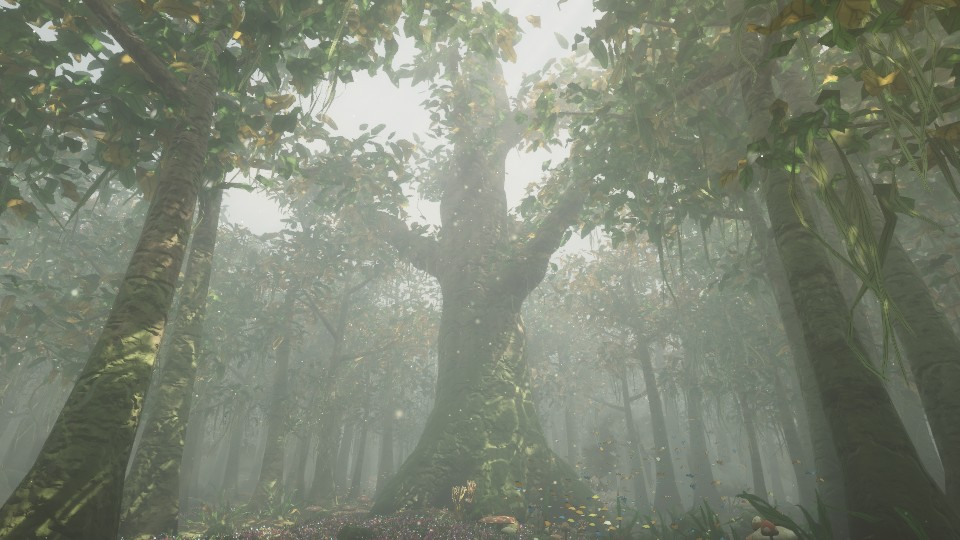
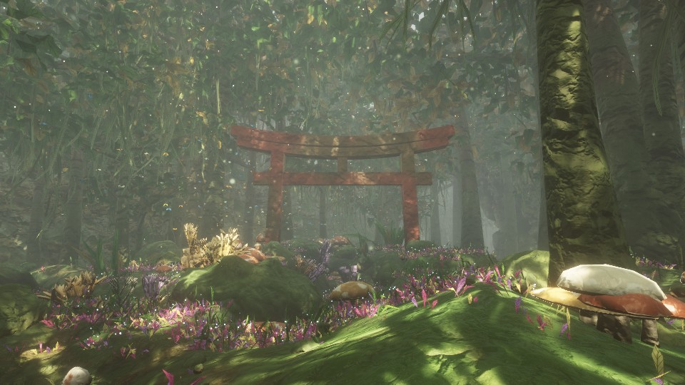
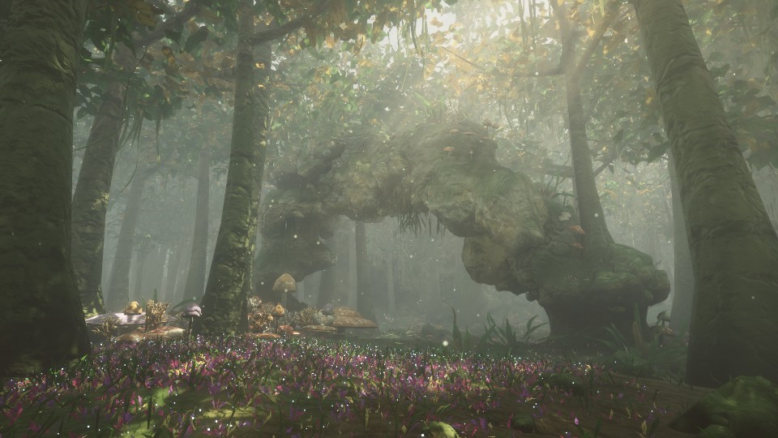
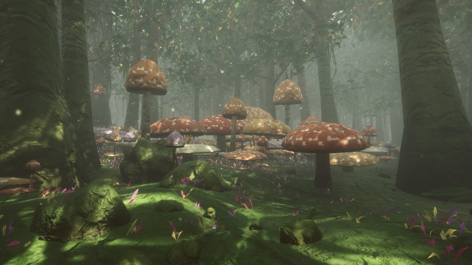
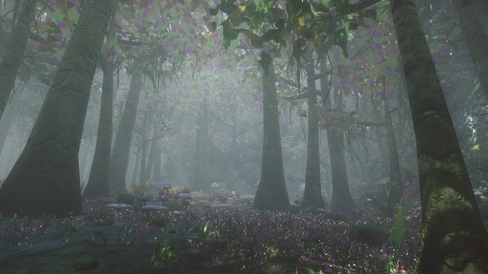
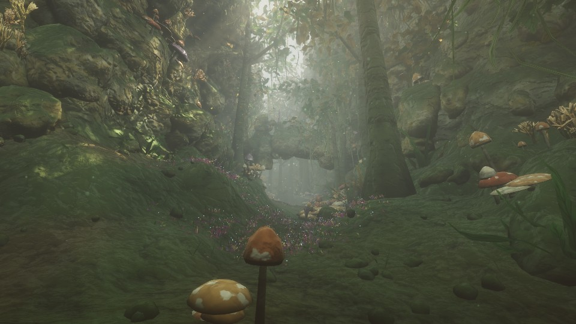

# Mistwood 霧林

**晨霧裡的巨木森林，直接在瀏覽器裡飛行穿梭。**

參天巨木、穿過樹冠的光柱、苔蘚拱門、蘑菇林、朱紅鳥居、蝴蝶群與白鳥。
全部由程式產生：沒有圖片、沒有 3D 模型、沒有音檔。整個世界是**一個約 106 KB 的 HTML 檔**（gzip 約 43 KB）。

**線上試玩：<https://weilee10334.github.io/abyssal-garden/>**



> 本專案 fork 自 [Noniv/abyssal-garden](https://github.com/Noniv/abyssal-garden)（MIT 授權）。
> 原作是海底世界；這裡沿用它的架構與 renderer，換成一個全新的森林場景，並加上裝置支援度診斷。

## 怎麼開

1. 直接開上面的網址，或下載 [`index.html`](index.html) 用瀏覽器開啟。
2. 等幾秒讓世界生成，按 **走進森林**。

不需安裝，離線也能跑。需要支援 **WebGPU** 的瀏覽器。

## 裝置支援與診斷

WebGPU 用的是裝置本身的 GPU，所以能不能跑取決於瀏覽器、作業系統與繪圖晶片，而不是這個 HTML 檔。

| 平台 | 需求 |
|---|---|
| 電腦 Chrome / Edge | 113 以上 |
| Android Chrome | Chrome 121 以上、Android 12 以上，且繪圖晶片在 Chrome 核可名單內 |
| iPhone / iPad | iOS / iPadOS 26 以上（所有瀏覽器皆同） |
| Firefox | Windows 141 以上、Apple 晶片 Mac 145 以上；Android 尚未預設開啟 |
| Safari（Mac） | 26 以上 |

無法啟動時，頁面不會只顯示「不支援」，而是依偵測結果列出這台裝置該怎麼做，例如：

- iPhone：需要更新到 iOS 26，或在 iOS 17.4–18 的 Safari 功能旗標開啟 WebGPU 預覽。
- Android：Chrome 太舊就提示更新；版本夠新但晶片不在核可名單時，引導開啟 `chrome://flags/#enable-unsafe-webgpu`（點網址可複製）。
- LINE、Facebook 等 App 內建瀏覽器：提示改用 Chrome 或 Safari 開啟。
- 有 WebGPU 但拿不到繪圖裝置：提示檢查圖形加速設定，並判斷是否只支援 OpenGL ES 相容模式。
- 頁面底部附一行裝置資訊，方便回報問題。

在網址後面加上 `?diag`，可以在支援的裝置上預覽這份診斷報告。

可以啟動時，選單底部會顯示偵測到的繪圖晶片；若是在 App 內建瀏覽器或軟體繪圖模式下執行，載入時會提示。

## 場景

| | |
|---|---|
|  |  |
|  |  |



- **巨木**：約 1,900 棵、三種樹形，樹幹是網格，約 160 萬片葉子掛在枝梢上
- **神木**：中央林地的巨樹，由膠囊 SDF 轉成網格
- **光**：穿過樹冠的光柱、地面的樹影光斑、霧氣隨距離變濃
- **地形**：丘陵、岩壁、苔蘚拱門、峽谷與石橋、隧道
- **蘑菇林、珊瑚菌、花毯、蕨類、垂掛的苔蘚**
- **生物**：蝴蝶群、白鳥、上升的孢子、飄浮的微塵
- **藍色林地**：光與霧偏冷，樹葉帶虹彩
- **聲音**：即時合成的風聲、樹冠沙沙聲與鳥鳴

## 操作

| | 鍵盤與滑鼠 |
|---|---|
| 環顧 | 移動滑鼠 |
| 移動 | `W` `A` `S` `D` |
| 上升 / 下降 | `E` / `Q` |
| 加速 | 按住 `Shift` |
| 跳到景點 | `1` 到 `6`（即上面的截圖位置） |
| 選單 | `Esc` |
| 靜音 | `M` |
| 效能數據 | `H` |
| 畫質 | 選單中的 **低**、**中**、**高**（會重新載入） |

地面與岩壁是實心的；樹、蘑菇與鳥居可以穿過去。

**觸控螢幕：**單指按住前進、滑動轉向，第二指加速，角落的 `≡` 開啟選單。手機一律以橫向顯示。（觸控為實驗性功能。）

介面依瀏覽器語言顯示中文或英文。

## 畫質等級

| 等級 | 內容 | 首次造訪時 |
|---|---|---|
| **高** | 完整場景 | 電腦 |
| **中** | 葉子、光點、石頭減半；小石頭與蘑菇不投影 | 記憶體 8 GB 的手機 |
| **低** | 葉子剩四分之一、無反鋸齒、較粗的網格與光照，起始 480p | 其他手機、記憶體 4 GB 以下的電腦 |

載入時分頁崩潰或繪圖驅動中斷，下次會自動降一級。執行中以 60 fps 為目標，依序調降解析度與繪製距離。

## 與原作的差異

沿用不變的部分：GPU compute 產生地形密度場、surface nets、instance 葉片、烘焙陰影與天光體積、半解析度體積光、bloom、格狀剔除、動態解析度、碰撞。

改動的部分：

| 檔案 | 改了什麼 |
|---|---|
| [`source/src/world.js`](source/src/world.js) | 全新的世界佈局；海帶柱改為樹（`meshTree` 樹幹網格 + 枝梢葉叢）；神木、鳥居、蘑菇、鳥、蝴蝶的網格 |
| [`source/src/shaders.js`](source/src/shaders.js) | 水的吸收改為霧；焦散改為樹影光斑；水面改為霧頂；樹皮、蘑菇、土壤與苔蘚材質；葉片配色；蝴蝶拍翅 |
| [`source/src/main.js`](source/src/main.js) | 太陽角度、六個景點與飛行路徑、樹幹的繪製與陰影、啟動流程改為診斷式 |
| [`source/src/support.js`](source/src/support.js) | 新增：裝置支援度診斷與中英文切換 |
| [`source/src/audio.js`](source/src/audio.js) | 海底環境音改為森林環境音 |
| [`source/template.html`](source/template.html) | 配色、文字、診斷報告的版面 |

[`prompt.txt`](prompt.txt) 是原作海底場景的原始 prompt，保留供參考。

## 自己改

需要 [Node.js](https://nodejs.org) 18 以上：

```bash
cd source
npm install
npm run build
```

會在 README 旁產生新的 `index.html`。`npm run build:readable` 產生未壓縮版本；`npm run build:dev` 產生 `dev.html`，多了 `F`（沿路徑飛行）、`B`（效能測試），以及用網址指定鏡頭：`dev.html#x,y,z,tx,ty,tz`。

幾個容易下手的地方：

- **霧與光的顏色**：`shaders.js` 開頭的 `WCOL`（霧）、`SUNC`（陽光）、`SIG`（霧的濃度）
- **世界佈局**：`world.js` 開頭的 `MESAS`（岩壁）、`ARCHES`（拱門）、`HOLES`（隧道）
- **樹的密度**：`world.js` 的 `KELPZ`（樹林）與 `NOKELP`（空地）
- **亮度與光柱**：`main.js` 的 `EXPO` 與 `RAYS`

## 已知限制

- 截圖是在無 GPU 的環境以軟體繪圖產生；實機的畫面與幀率尚待驗證。
- iPhone 上的 WebGPU 未實測。
- 每次開啟都要重新生成世界，載入期間記憶體用量高，記憶體小的手機可能失敗。

## 授權

[MIT](LICENSE)。原作 © Noniv；本 fork 的修改同樣以 MIT 釋出。
